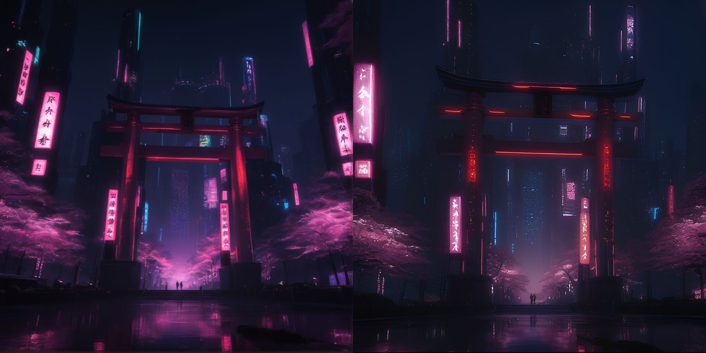
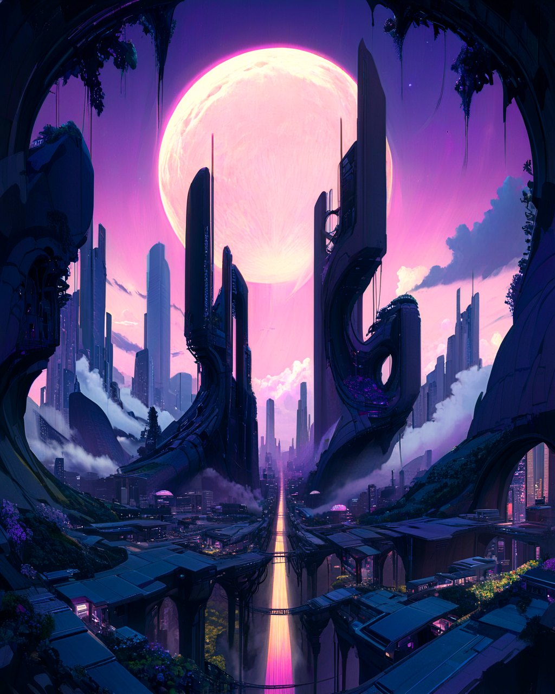
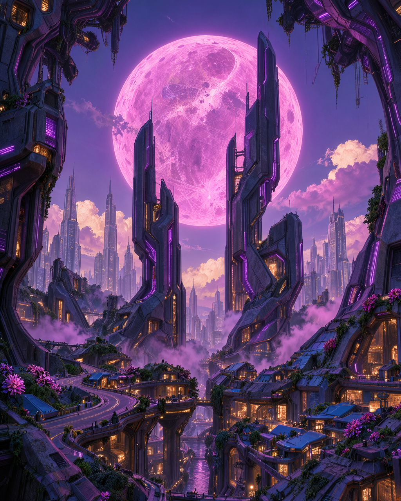

# Arch Forge

**A creative upscaler for architectural and sci-fi imagery in ComfyUI.** It combines structural guidance, configurable detail and texture LoRAs, perspective correction, and a final model-based upscale in a single node. It is designed to enrich materials and architectural detail, with settings that can allow creative reinterpretation rather than strict source reconstruction.
A single compact node combines SDXL img2img (or the new two-pass MOSS flow), up to four LoRAs, Canny and Depth guidance, ambient occlusion, model upscaling, Lucy-Richardson sharpening, final sharpening, and conservative vertical-perspective straightening.
> **Positioning:** Arch Forge is for fast, local architectural-environment exploration—especially sci-fi, cyberpunk, game art, concept art, and realistic architecture—not a replacement for BIM, CAD, technical visualization, or image-to-video production pipelines.

 
---


## MOSS workflow (new)
Arch Forge now has a second engine. The **workflow** switch at the top of the node panel selects **SDXL** (default, unchanged) or **MOSS**. MOSS replaces only the part of the node from the model/image loaders to the sampler with a two-pass MOSS-Image flow; ambient occlusion, upscale, sharpening and perspective straightening are shared and behave exactly as before.

**Reference images for MOSS** — the input image (left) and the result of the MOSS workflow (right):

| Input | MOSS output |
|---|---|
|  |  |

> **Release note:** these images and their example workflows are the MOSS reference set. A new version of the custom node, including the MOSS workflow, will be uploaded to the ComfyUI Registry once the new examples are up in this repository. Until then, install from GitHub.

### How the MOSS flow works
1. A depth map (MiDaS) is made from the input image and used by the depth control LoRA in pass 1.
2. Pass 1 samples from `start_at_step` to `end_at_step` with the depth-guided model and depth-image text encoders.
3. Pass 2 continues from `end_at_step` to `steps`. With **keep_artifacts** on, it uses the canny control LoRA, a Canny map and the VAE in the text encoders. With it off, it uses no canny LoRA, the original image and no VAE in the encoders.
4. The result is decoded with the MOSS VAE and goes through the same post-production chain as SDXL.

LoRAs 1–3 are applied to both passes. LoRA 4 is applied to pass 2 only, and its CLIP is used by every text encode.

### MOSS inputs
| UI group | MOSS controls |
|---|---|
| **Models** | `moss_unet_name`, `moss_clip_name` (type flux2), `moss_vae_name`, LoRA slots 1–4 |
| **Canny** | `moss_canny_lora` (strength = `canny_strength`), `moss_canny_low`, `moss_canny_high`, `moss_canny_resolution`, `keep_artifacts` |
| **Depth** | `moss_depth_lora` (strength = `depth_strength`), `depth_resolution`, `depth_midas_a`, `depth_midas_bg_threshold` |
| **Sampling** | `seed`, `steps`, `cfg`, `sampler_name`, `scheduler`, `start_at_step`, `end_at_step`, `moss_leftover_noise_handoff` |
The panel shows only the fields of the selected workflow. `depth_controlnet`, `depth_start` and `depth_end` apply to SDXL only.

Settings used for the reference images: steps `25`, cfg `2.5`, sampler `er_sde`, scheduler `simple`, start `6`, end `14`, depth strength `1.0`, canny strength `0.6`, Canny `120` / `220` at resolution `1024`, MiDaS `bg_threshold` `0.5`.

MOSS needs the MOSS-Image models from [Comfy-Org/MOSS-Image](https://huggingface.co/Comfy-Org/MOSS-Image) (diffusion model, text encoder and VAE), the depth and canny control LoRAs, a ComfyUI build that includes `TextEncodeMOSSImageEdit`, and ComfyUI ControlNet Auxiliary Preprocessors for `CannyEdgePreprocessor` and MiDaS.

## Why Arch Forge
Architectural image workflows can sprawl across many node graphs and optional preprocessing packs. Arch Forge packages a practical SDXL-oriented enhancement chain into one ComfyUI node, with grouped controls for source preservation, depth, composition, post-processing, and output detail.
| | Arch Forge | Large multi-stage archviz workflows |
|---|---|---|
| Core use | Enhance and upscale an illustration, render, or concept into an architectural environment image | Full image, editing, camera-control, and often video pipeline |
| Form factor | One ComfyUI custom node | Large workflows, subgraphs, or multiple JSON files |
| Model focus | SDXL checkpoints, LoRAs, ControlNet, plus a MOSS two-pass mode | Often FLUX-class image models and video stacks |
| Hardware target | Practical local SDXL systems; 8–12 GB VRAM is a useful starting point | Often larger GPUs, cloud runs, or staged execution |
| Output | Realistic upscaled still image | Still images, editing passes, animation, and video |
| Best for | Rapid local exploration and structured concept enhancement | Long-form technical archviz production |
## Features
- **One-node workflow** — wraps the enhancement chain in one Arch Forge node.
- **Two engines** — SDXL (default) or MOSS two-pass, chosen with the workflow switch.
- **SDXL-first design** — intended for local SDXL checkpoints, LoRAs, ControlNets, and upscalers.
- **Four LoRA slots** — independent model and CLIP strength controls for each LoRA.
- **Dual ControlNet guidance** — Canny preserves structural edges; MiDaS depth supports scene volume and depth-aware generation.
- **Native perspective straighten** — conservative roll and vertical-keystone correction based on line detection, robust vanishing-point estimation, and a camera-rotation homography.
- **Ambient occlusion pass** — optional MiDaS-driven SSAO compositing for restrained depth shading.
- **Upscale and sharpening chain** — model upscale, optional Lucy-Richardson sharpening, then optional final sharpen.
- **Compact grouped UI** — Models, Prompts, Canny, Depth, Sampling, AO, Sharpen, Straighen, and Upscale controls are collapsed by default.

## Version 1.0 — benchmark comparison with impact pack 

Developer-run measurements collected on November 10, 2026, on an NVIDIA GeForce RTX 3060 with 12 GB VRAM, Windows, and PyTorch 2.11.0+cu130. These results describe the tested version 1.0 configurations, not every preset or later release.

The comparison measures elapsed time from the start of the second SDXL sampling call to workflow termination. It excludes the initial 25-step image-generation sampler and includes downstream decoding, enlargement, finishing, and output saving where executed. Processing before that second sampling call is excluded. These are pipeline-interval measurements, not isolated upscale-node timings.

| Configuration | Recorded sampling steps | Sampling call | Time after sampling until workflow ends | Combined elapsed time |
|---|---:|---:|---:|---:|
| Arch Forge 2× | 17 | 41.19 s | 11.79 s | 52.98 s |
| Impact Pack 2× | 20 | 175.04 s | 22.37 s | 197.41 s |
| Arch Forge 4× | 17 | 40.42 s | 33.92 s | 74.34 s |
| Impact Pack 4× | 20 | 1,649.58 s | 891.22 s | 2,540.80 s (42 min 21 s) |

Combined elapsed time = `workflow_end_time - sampling_data[1].sampler_sample_start_time`. The final column is calculated from unrounded timestamps, so displayed component sums can differ by 0.01 s.

In these captures, the Impact Pack interval was 3.73 times as long at 2× and 34.18 times as long at 4×. These are observed interval ratios, not matched-settings speedups or image-quality comparisons. Arch Forge performs its final neural enlargement after diffusion sampling; the Impact provider performs enlargement before its upscale sampling pass. Because the interval starts at sampling, the Impact preprocessing is not included.

### Measurement limits

- One capture per configuration; no repeated-run medians or controlled cold/warm comparison.
- Different recorded step counts (17 versus 20); matching sampling resolution, algorithm, conditioning, and denoise has not been established. Attribution of the Arch Forge second sampling calls should be verified against the executed workflows.
- The post-sampling column is not pure neural-upscale inference time: it includes all remaining recorded workflow time.
- The Impact Pack 4× final decode is flagged `valid_timing: false`. Its end-to-end interval includes that period; neither this interval nor the presence of a workflow end timestamp proves successful output saving. Treat that row as a diagnostic result, not a validated successful completion.
- No isolated upscaler VRAM or RAM claim is made. These tests do not establish compatibility with 8 GB GPUs.
- [Benchmark files](https://drive.google.com/drive/folders/1XNS9gTpFzeOiOHFKHRbmMNiWj1JOyIaf)


## Installation
### ComfyUI Manager
Once published, search for **Arch Forge** in ComfyUI Manager and choose **Install**. The MOSS workflow will reach the Registry version when the new examples are published (see the release note in the MOSS section).
### Manual installation
```bash
cd ComfyUI/custom_nodes
git clone https://github.com/YOUR_USERNAME/ComfyUI-ArchForge.git arch_forge
cd arch_forge
../../python_embeded/python.exe -m pip install -r requirements.txt
```
Restart ComfyUI after installation, then hard-refresh the browser if the custom UI does not appear immediately.
## Requirements
- ComfyUI with a current frontend recommended.
- Python 3.10 or later.
- An SDXL-compatible checkpoint (SDXL workflow) or the MOSS-Image models (MOSS workflow).
- An NVIDIA GPU; 8–12 GB VRAM is a practical starting point, but actual use depends on source resolution, checkpoint, LoRAs, ControlNets, selected upscaler, and batch size.
- `opencv-python` and `numpy` for the native perspective-straightening helper.
Arch Forge’s native straightener uses OpenCV LSD line detection and standard NumPy/OpenCV geometry. It does not require a separate perspective-correction custom node.
## Dependencies
Arch Forge calls several registered ComfyUI nodes. Install the corresponding packs for the features you intend to use.
| Dependency | Used for | Required? |
|---|---|---|
| [ComfyUI ControlNet Auxiliary Preprocessors](https://github.com/comfyorg/comfyui-controlnet-aux) | `MiDaS-DepthMapPreprocessor` for Depth ControlNet and SSAO depth maps; `CannyEdgePreprocessor` for MOSS | Required for depth pipeline / SSAO / MOSS canny |
| [WAS Node Suite](https://github.com/WASasquatch/was-node-suite-comfyui) | `Image SSAO (Ambient Occlusion)` and `Image Lucy Sharpen` | Required only when SSAO or Lucy Sharpen is enabled |
Core ComfyUI supplies the checkpoint, LoRA, ControlNet, sampler, VAE, ImageBlend, ImageSharpen, and model-upscale nodes used by the workflow.
### Important: two perspective tools
Arch Forge has two intentionally separate tools:
- **Perspective straighten** is the preferred architecture correction. It detects reliable vertical structure, estimates camera roll and pitch, and uses a rotation-only homography to reduce converging verticals. It is conservative: uncertain images remain unchanged rather than being aggressively warped.
## Quick start
1. Add **Arch Forge** from the `arch_forge` category.
2. Connect a sketch, clay render, concept render, or base architectural image to `input_image`.
3. Pick the engine with the workflow switch at the top of the panel (SDXL or MOSS).
4. Open **Models** and choose an SDXL checkpoint (or the MOSS model, text encoder and VAE), optional LoRAs, the ControlNets or control LoRAs, and an upscale model.
5. Open **Prompts** and adapt the positive and negative prompts to the intended material, lighting, place, and camera treatment.
6. Start with the default Canny and Depth values, then queue the workflow.
7. Enable post-processing one stage at a time while testing a fixed seed.
8. For visible keystone, open **Persp Straighen**, enable it, use Auto-crop, and start at Strength `0.70` to `1.00`.
## Included workflow
The repository currently includes one sample workflow:
```text
examples/scifi-tunnel-archforge.json
```
### Sci-fi tunnel
`scifi-tunnel-archforge.json` is the current reference workflow for an enclosed neon-lit sci-fi/cyberpunk environment. It demonstrates the expected node configuration and output path for the current release.
Suggested starting values:
- Canny strength: `0.80`
- Canny timing: `0.00–0.90`
- Depth strength: `0.50`
- Depth timing: `0.20–0.70`
- SSAO strength: `0.30`
- SSAO blend factor: `0.20`, mode `multiply`
- Lucy iterations / kernel: `3` / `5`
- Final sharpen: radius `1`, sigma `1.0`, alpha `0.5`
- Perspective straighten: enable only after comparing against the uncorrected fixed-seed image
An **outdoor building workflow** is planned and will be added in a future update, together with the MOSS example workflows.
## Control groups
The custom UI starts compact and keeps all groups collapsed. Clicking a group shows its ComfyUI widgets and resizes the node to fit the visible inputs. The fields shown depend on the workflow switch.
| UI group | Main controls |
|---|---|
| **Models** | Checkpoint (SDXL) or MOSS model/text encoder/VAE, plus four LoRA slots and strengths |
| **Prompts** | Positive and negative prompts |
| **Canny** | Canny ControlNet (SDXL) or canny LoRA and `keep_artifacts` (MOSS), strength, thresholds |
| **Depth** | Depth ControlNet (SDXL) or depth LoRA (MOSS), strength/timing, MiDaS resolution and parameters |
| **Sampling** | Seed, steps, CFG, sampler, scheduler, and img2img step range |
| **Ambient Occlusion** | MiDaS depth resolution, SSAO controls, and blend settings |
| **Sharpen** | Lucy sharpening and final sharpening controls |
| **Persp Straighen** | Native auto-straighten enable, strength, and crop control |
| **Upscale** | Selected ComfyUI upscale model |
The label **Persp Straighen** keeps the spelling used by the shipped interface.
## Controls
### Models
| Parameter | Description |
|---|---|
| `checkpoint_name` | SDXL checkpoint used for generation |
| `lora_name_1` through `lora_name_4` | Up to four optional LoRA files (in MOSS, slot 4 applies to pass 2 only) |
| `lora_strength_*_model` | Model-side strength for each LoRA |
| `lora_strength_*_clip` | CLIP-side strength for each LoRA |
### Prompts
| Parameter | Description |
|---|---|
| `positive_prompt` | Desired scene, materials, lighting, atmosphere, style, and camera qualities |
| `negative_prompt` | Artifacts, unwanted styles, impossible geometry, and other things to avoid |
### Canny
| Parameter | Description |
|---|---|
| `canny_controlnet` | Canny/edge ControlNet model |
| `canny_strength` | Overall Canny conditioning strength |
| `canny_start` / `canny_end` | Denoising range during which Canny conditioning applies |
| `canny_enable_threshold` | Enables thresholded Canny preprocessing |
| `canny_threshold_low` / `canny_threshold_high` | Canny threshold range |
### Depth
| Parameter | Description |
|---|---|
| `depth_controlnet` | Depth ControlNet model |
| `depth_strength` | Overall Depth conditioning strength |
| `depth_start` / `depth_end` | Denoising range during which Depth conditioning applies |
| `depth_resolution` | MiDaS depth-preprocessor analysis resolution |
| `depth_midas_a` | MiDaS depth preprocessor parameter |
| `depth_midas_bg_threshold` | MiDaS background threshold |
### Sampling
| Parameter | Description |
|---|---|
| `seed` | Random seed |
| `steps` | Total sampling steps |
| `cfg` | Classifier-free guidance scale |
| `sampler_name` | ComfyUI sampler |
| `scheduler` | ComfyUI scheduler |
| `start_at_step` | Img2img denoising start step |
| `end_at_step` | Img2img denoising end step (MOSS: handoff between pass 1 and pass 2) |
Require `0 ≤ start_at_step < end_at_step ≤ steps`.
### Ambient Occlusion
| Parameter | Description |
|---|---|
| `enable_ssao` | Enables the post-decode SSAO pass |
| `ssao_resolution` | MiDaS depth resolution used for SSAO |
| `ssao_strength` | Ambient-occlusion intensity |
| `ssao_radius` | Occlusion neighborhood radius |
| `ssao_blur` | AO blur amount |
| `ssao_specular_threshold` | Threshold for the optional specular mask |
| `ssao_enable_specular` | Enables specular masking in the SSAO node |
| `ssao_tile_size` | SSAO tile size |
| `ssao_blend_factor` | Blend strength between decoded image and SSAO composite |
| `ssao_blend_mode` | Image blend mode; the tunnel workflow uses `multiply` |
SSAO is optional. It is usually more useful as restrained depth shading than as a heavy effect.
### Upscale and sharpen
| Parameter | Description |
|---|---|
| `upscale_model` | Model selected from ComfyUI’s `upscale_models` directory |
| `enable_lucy` | Enables WAS Suite Lucy-Richardson sharpening after upscale |
| `lucy_iterations` | Lucy sharpening iterations |
| `lucy_kernel_size` | Lucy deconvolution kernel size; use an odd number |
| `enable_final_sharpen` | Enables final ImageSharpen pass |
| `sharpen_radius` | Final sharpen radius |
| `sharpen_sigma` | Final sharpen sigma |
| `sharpen_alpha` | Final sharpen intensity |
Recommended first test after upscaling:
```text
Lucy: enabled, 3 iterations, kernel 5
Final sharpen: enabled, radius 1, sigma 1.0, alpha 0.5
```
If the image becomes grainy, reduce Lucy iterations or disable the final sharpen before increasing sharpening values.
### Perspective straighten
| Parameter | Default | Description |
|---|---:|---|
| `enable_perspective_correction` | `false` | Enables native roll/vertical-keystone correction after post-processing |
| `perspective_strength` | `1.0` | Scales the detected roll and pitch correction from 0 to 1 |
| `perspective_auto_crop` | `true` | Keeps a valid same-aspect output crop after correction |
The straightener runs after upscale, Lucy sharpening, and optional final sharpening. It does not use the manual Corner Pin settings.
## Perspective straighten notes
The native straightener is deliberately conservative. It uses LSD line detection, a robust vertical-vanishing-point search, a confidence gate, and a camera-rotation homography:
\[
H = K R K^{-1}
\]
where `K` is estimated camera intrinsics and `R` removes roll and pitch. It does **not** automatically apply yaw/fronto-parallel facade correction, because that can distort multi-plane scenes such as tunnels, streets, and corner views.
Expected results:
- For facades and clear buildings: reduced vertical keystone and more upright lines.
- For corridors, tunnels, or scenes with multiple depth planes: subtle improvement or no change if the evidence is uncertain.
- For unreliable geometry: the original image is returned unchanged rather than forcing a warp.
For best results:
- Start at Strength `0.70–0.85`; use `1.00` to inspect the full proposed correction.
- Keep Auto-crop enabled.
- Test with a fixed seed and compare correction off versus on.
- Do not expect all 3D lines in a deep tunnel to become parallel; genuine one-point perspective should remain.
- Disable it for intentionally tilted, heavily organic, fisheye, or non-architectural images.
## Troubleshooting
### Node does not appear
- Confirm the repository is under `ComfyUI/custom_nodes/arch_forge`.
- Confirm `__init__.py` exports `NODE_CLASS_MAPPINGS`, `NODE_DISPLAY_NAME_MAPPINGS`, and `WEB_DIRECTORY = "./web"`.
- Restart ComfyUI and inspect the terminal for an Arch Forge import error.
### Custom UI does not update
- Confirm the JavaScript file is in the package `web/` directory and is served through `WEB_DIRECTORY`.
- Restart ComfyUI, then hard-refresh the browser with `Ctrl+Shift+R` or `Ctrl+F5`.
- Add a new Arch Forge node after changing Python input definitions; older saved nodes can retain incompatible positional widget values.
### MOSS workflow errors
- Select the MOSS model, text encoder, VAE and depth LoRA in **Models** and **Depth**; with `keep_artifacts` on, also select the canny LoRA in **Canny**.
- If `TextEncodeMOSSImageEdit` is reported as missing, update ComfyUI to a build that includes it.
### Required node pack is missing
The backend reports the exact registered node name it cannot find. Install or enable the relevant pack, then restart ComfyUI.
- MiDaS depth preprocessing and MOSS canny: install ComfyUI ControlNet Auxiliary Preprocessors.
- SSAO or Lucy Sharpen: install WAS Node Suite.
### Perspective straighten changes little or nothing
- Confirm **Persp Straighen** is enabled.
- Use clear architectural images with visible, reliable vertical structure.
- Test Strength `1.00` against the same fixed-seed result.
- A no-change result can be intentional: the safety gate refuses uncertain or overly destructive corrections.
### OpenCV verification
Run this with ComfyUI’s embedded Python if the straightener cannot import:
```bat
.\python_embeded\python.exe -c "import cv2, numpy; print('OpenCV:', cv2.__version__); print('NumPy:', numpy.__version__)"
```
## Project structure
```text
arch_forge/
├── __init__.py
├── arch_forge_node.py
├── perspective/
│   ├── __init__.py
│   └── core.py
├── web/
│   └── arch_forge.js
├── examples/
│   ├── moss/
│   │   ├── urban-purple-jungle_00009.jpg
│   │   └── stray-moss_00048.jpg
│   └── scifi-tunnel-archforge.json
├── requirements.txt
├── pyproject.toml
├── LICENSE
└── README.md
```
An outdoor-building example workflow and the MOSS example workflows are planned but are not yet included.
## ComfyUI Registry
Arch Forge is intended for ComfyUI Registry publication through `pyproject.toml`. A new version of the custom node, including the MOSS workflow, will be uploaded to the registry when the new examples are up. Before publishing:
1. Replace GitHub and ComfyUI publisher placeholders.
2. Keep `LICENSE`, `README.md`, `requirements.txt`, and `pyproject.toml` in the repository root.
3. Validate installation in a clean ComfyUI environment with all documented optional packs installed.
4. Increment the semantic version in `pyproject.toml` for every release.
Suggested description:
```toml
description = "One-node SDXL architectural environment enhancer for ComfyUI with dual ControlNet, optional SSAO, upscale/sharpening, manual corner pin, and conservative vertical-perspective straightening."
```
## Changelog
### Unreleased (next Registry version)
- Added the **workflow** switch (SDXL / MOSS) at the top of the node panel; the panel shows only the fields of the selected workflow.
- Added the two-pass MOSS flow with depth and canny control LoRAs, the `keep_artifacts` option, and the optional leftover-noise handoff.
- Added a fourth LoRA slot (pass 2 only in MOSS)
- Added MOSS reference images under `examples/`; example workflows will follow.
### v1.2.0
- Reworked the compact UI into Models, Prompts, Canny, Depth, Sampling, Ambient Occlusion, Sharpen, Persp Straighen, and Upscale groups.
- Added MiDaS-driven optional SSAO with compositing controls.
- Added optional WAS Suite Lucy-Richardson sharpening before final sharpen.
- Replaced the earlier native perspective heuristic with conservative camera-rotation vertical correction.
- Perspective correction now uses robust line evidence, a confidence gate, valid crop planning, and does not apply automatic yaw correction.
- Added `scifi-tunnel-archforge.json` as the current sample workflow.
- Outdoor-building example workflow is planned.
### v1.1.0
- Added integrated auto-straighten perspective controls.
- Removed the **Persp wrap** button from the UI.
### v1.0.0
- Initial Arch Forge release.
- SDXL architecture/environment enhancement workflow.
- Three LoRA slots, Canny and Depth ControlNet, img2img sampling, upscale, and sharpen controls.
## Credits
- Built by [jeeltcraft](https://www.jeeltcraft.com/)
- Built on ComfyUI, SDXL, ControlNet, OpenCV, and the ComfyUI custom-node ecosystem
- Native perspective-straightening design informed by the camera-rotation, line-detection, vanishing-point, and crop-planning approach in [metamountain/Perspective-Correction](https://github.com/metamountain/Perspective-Correction)
## License
MIT — see [LICENSE](LICENSE).
