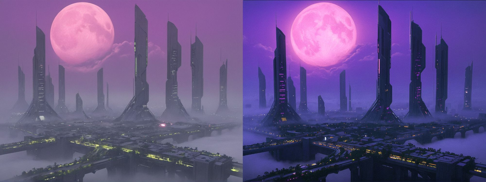
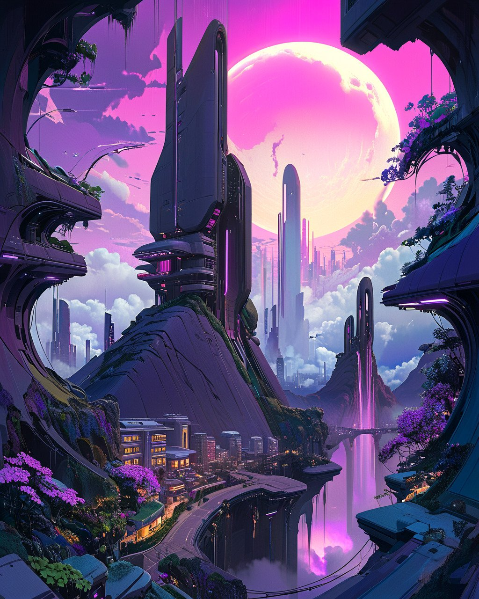
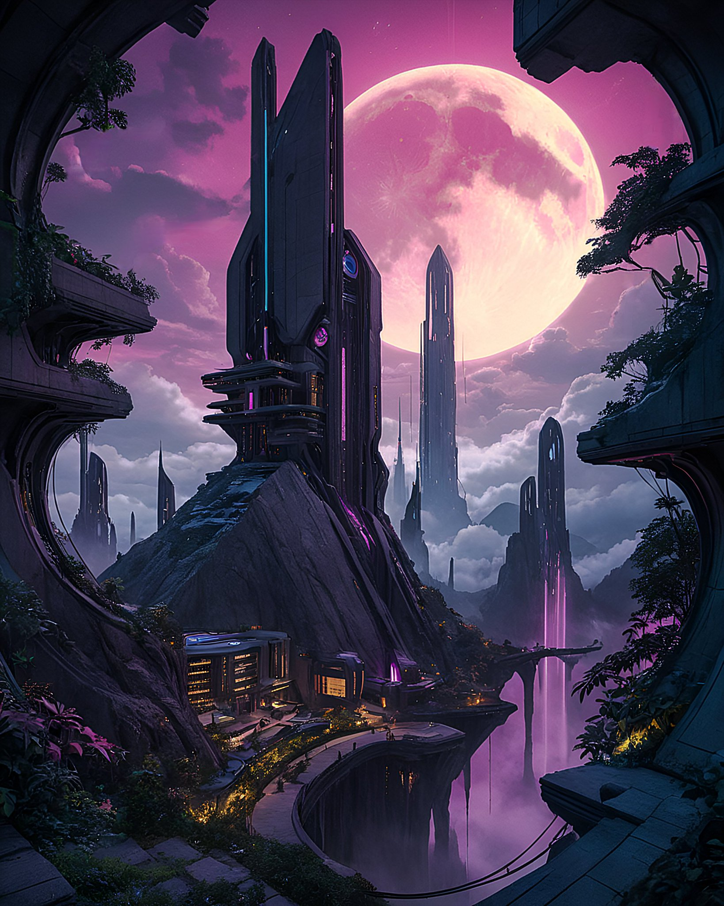

# Arch Forge

**A local, creative upscaler for architectural and sci-fi imagery in ComfyUI.**
Feed it a drawing, clay render, viewport capture or concept image, depth map based creative upscaler. Get back a finished, upscaled architectural or 3D conversion ready image, generated on your own low VRAM GPU, in one node.

 

---

| Input | SDXL output |
|---|---|
|  |  |

| Input | MOSS output |
|---|---|
|  |  |

## Version 1.0 — benchmark comparison with impact pack

Developer-run measurements collected on November 10, 2026, on an NVIDIA GeForce RTX 3060 with 12 GB VRAM, Windows, and PyTorch 2.11.0+cu130. These results describe the tested version 1.0 configurations (SDXL engine), not every preset or later release.

The comparison measures elapsed time from the start of the second SDXL sampling call to workflow termination. It excludes the initial 25-step image-generation sampler and includes downstream decoding, enlargement, finishing, and output saving where executed. Processing before that second sampling call is excluded. These are pipeline-interval measurements, not isolated upscale-node timings.

| Configuration | Recorded sampling steps | Sampling call | Time after sampling until workflow ends | Combined elapsed time |
|---|---:|---:|---:|---:|
| Arch Forge 2× | 17 | 41.19 s | 11.79 s | 52.98 s |
| Impact Pack 2× | 20 | 175.04 s | 22.37 s | 197.41 s |
| Arch Forge 4× | 17 | 40.42 s | 33.92 s | 74.34 s |
| Impact Pack 4× | 20 | 1,649.58 s | 891.22 s | 2,540.80 s (42 min 21 s) |

Combined elapsed time = `workflow_end_time - sampling_data[1].sampler_sample_start_time`. The final column is calculated from unrounded timestamps, so displayed component sums can differ by 0.01 s.

In these captures, the Impact Pack interval was 3.73 times as long at 2× and 34.18 times as long at 4×. These are observed interval ratios, not matched-settings speedups or image-quality comparisons. Arch Forge performs its final neural enlargement after diffusion sampling; the Impact provider performs enlargement before its upscale sampling pass. Because the interval starts at sampling, the Impact preprocessing is not included.

### Measurement limits

- One capture per configuration; no repeated-run medians or controlled cold/warm comparison.
- Different recorded step counts (17 versus 20); matching sampling resolution, algorithm, conditioning, and denoise has not been established. Attribution of the Arch Forge second sampling calls should be verified against the executed workflows.
- The post-sampling column is not pure neural-upscale inference time: it includes all remaining recorded workflow time.
- The Impact Pack 4× final decode is flagged `valid_timing: false`. Its end-to-end interval includes that period; neither this interval nor the presence of a workflow end timestamp proves successful output saving. Treat that row as a diagnostic result, not a validated successful completion.
- [Benchmark files](https://drive.google.com/drive/folders/1XNS9gTpFzeOiOHFKHRbmMNiWj1JOyIaf)


## Who it is for

Arch Forge is built for people who **already run ComfyUI** and want a repeatable, one-node way to enrich architectural images:

- Archviz freelancers and studios who want a private, no-per-render-fee enhancement pass on client material.
- Concept and environment artists (sci-fi, cyberpunk, game art) who need materials, lighting and detail added to a blockout without losing the layout.
- Anyone replacing a sprawl of preprocessing, ControlNet, upscale and sharpen nodes with one grouped control panel.

**Not for:** BIM/CAD-exact visualization, plugin-inside-your-modeller workflows, hosted/no-GPU use, or video pipelines. Cloud tools and host-software plugins are the better fit for those. Arch Forge trades convenience for control, privacy and zero per-image cost.

## Why local

| | Arch Forge | Typical paid cloud / plugin tools |
|---|---|---|
| Where it runs | Your GPU, inside ComfyUI | Vendor servers or a host-software plugin |
| Cost model | Free (MIT). Your hardware and electricity | Subscription and/or credits per render or upscale |
| Client material | Never uploaded by the node | Uploaded to the vendor service |
| Control | Models, LoRAs, ControlNets, samplers and post-production are all exposed | Curated presets and sliders |
| Setup | Install the node and a few node packs; bring your own models | Sign up and go |
| Best at | Repeatable, tweakable, private enhancement | Convenience, support, hosted capacity |

## Two engines, one node

A **workflow** switch at the top of the node panel selects the engine. Everything after the sampler (ambient occlusion, model upscale, Lucy and final sharpening, perspective straighten) is shared and behaves the same in both.

| | SDXL (default) | MOSS (new) |
|---|---|---|
| Structure guidance | Canny + Depth ControlNets | Depth control LoRA (pass 1), Canny control LoRA (pass 2, optional) |
| Models | SDXL checkpoint, up to 4 LoRAs | MOSS-Image model, text encoder and VAE, up to 4 LoRAs |
| Sampling | One img2img pass | Two passes: `start_at_step` to `end_at_step`, then `end_at_step` to `steps` |
| Good for | Fast local SDXL exploration on 8-12 GB GPUs | Detail-rich, prompt-faithful results with MOSS-Image |

### How the MOSS flow works
1. A depth map (MiDaS) is made from the input image and used by the depth control LoRA in pass 1.
2. Pass 1 samples from `start_at_step` to `end_at_step` with the depth-guided model and depth-image text encoders.
3. Pass 2 continues from `end_at_step` to `steps`. With **keep_artifacts** on, it uses the canny control LoRA, a Canny map and the VAE in the text encoders. With it off, it uses no canny LoRA, the original image and no VAE in the encoders.
4. The result is decoded with the MOSS VAE and goes through the same post-production chain as SDXL.

LoRAs 1-3 are applied to both passes. LoRA 4 is applied to pass 2 only, and its CLIP is used by every text encode.

Settings used for the MOSS reference images: steps `25`, cfg `2.5`, sampler `er_sde`, scheduler `simple`, start `6`, end `14`, depth strength `1.0`, canny strength `0.6`, Canny `120` / `220` at resolution `1024`, MiDaS `bg_threshold` `0.5`.

> **Release note:** the SDXL version is published on the ComfyUI Registry. A new version including the MOSS workflow is being released; until it appears in ComfyUI Manager, install from GitHub to use MOSS.

## Quick start

1. Install the node (see below) and restart ComfyUI. Hard-refresh the browser and add a **new** Arch Forge node (saved nodes keep an old widget list).
2. Connect a sketch, clay render, concept render or base architectural image to `input_image`.
3. Choose **SDXL** or **MOSS** with the switch at the top of the panel.
4. Open **Models** and pick your checkpoint (or MOSS model, text encoder and VAE), LoRAs, the ControlNets or control LoRAs, and an upscale model.
5. Open **Prompts** and describe materials, lighting, place and camera treatment.
6. Keep the default Canny and Depth values for the first run, with a fixed seed.
7. Enable post-processing one stage at a time and compare.
8. For visible keystone, open **Persp Straighen**, enable it, use Auto-crop, and start at strength `0.70` to `1.00`.

## Installation

### ComfyUI Manager / Registry
Search for **Arch Forge** in ComfyUI Manager and choose **Install**. The Registry currently carries the SDXL version; the MOSS-enabled version follows.

### Manual installation
```bash
cd ComfyUI/custom_nodes
git clone https://github.com/jilt/ArchForge.git arch_forge
cd arch_forge
../../python_embeded/python.exe -m pip install -r requirements.txt
```
Restart ComfyUI after installation, then hard-refresh the browser if the custom UI does not appear immediately.

### Requirements
- ComfyUI with a current frontend recommended.
- Python 3.10 or later.
- SDXL workflow: an SDXL-compatible checkpoint plus Canny and Depth ControlNets.
- MOSS workflow: the MOSS-Image models from [Comfy-Org/MOSS-Image](https://huggingface.co/Comfy-Org/MOSS-Image) (diffusion model, text encoder and VAE), the depth and canny control LoRAs, and a ComfyUI build that includes `TextEncodeMOSSImageEdit`.
- An NVIDIA GPU; 8-12 GB VRAM is a practical starting point, but actual use depends on source resolution, models, LoRAs, ControlNets, selected upscaler and batch size.
- `opencv-python` and `numpy` for the native perspective-straightening helper (OpenCV LSD line detection; no separate perspective-correction node needed).

### Node packs it calls
| Dependency | Used for | Required? |
|---|---|---|
| [ComfyUI ControlNet Auxiliary Preprocessors](https://github.com/comfyorg/comfyui-controlnet-aux) | `MiDaS-DepthMapPreprocessor` for depth and SSAO depth maps; `CannyEdgePreprocessor` for MOSS | Required for the depth pipeline, SSAO and MOSS canny |
| [WAS Node Suite](https://github.com/WASasquatch/was-node-suite-comfyui) | `Image SSAO (Ambient Occlusion)`, `Image Lucy Sharpen`, SDXL `Image Canny Filter` | Required when SSAO, Lucy Sharpen or the SDXL workflow is used |

Core ComfyUI supplies the checkpoint, LoRA, ControlNet, sampler, VAE, ImageBlend, ImageSharpen and model-upscale nodes.

## Control groups
The custom UI starts compact and keeps all groups collapsed. Clicking a group shows its widgets and resizes the node to fit; the fields shown depend on the workflow switch.

| UI group | Main controls |
|---|---|
| **Models** | Checkpoint (SDXL) or MOSS model/text encoder/VAE, plus four LoRA slots and strengths |
| **Prompts** | Positive and negative prompts |
| **Canny** | Canny ControlNet (SDXL) or canny LoRA and `keep_artifacts` (MOSS), strength, thresholds |
| **Depth** | Depth ControlNet (SDXL) or depth LoRA (MOSS), strength/timing, MiDaS resolution and parameters |
| **Sampling** | Seed, steps, CFG, sampler, scheduler, and step range |
| **Ambient Occlusion** | MiDaS depth resolution, SSAO controls, and blend settings |
| **Sharpen** | Lucy sharpening and final sharpening controls |
| **Persp Straighen** | Native auto-straighten enable, strength, and crop control |
| **Upscale** | Selected ComfyUI upscale model |

The label **Persp Straighen** keeps the spelling used by the shipped interface.

## Controls
### Models
| Parameter | Description |
|---|---|
| `workflow` | `SDXL` (default) or `MOSS`; set from the select at the top of the panel |
| `checkpoint_name` | SDXL checkpoint used for generation |
| `moss_unet_name`, `moss_clip_name`, `moss_vae_name` | MOSS diffusion model, text encoder (type flux2) and VAE |
| `lora_name_1` through `lora_name_4` | Up to four optional LoRA files (in MOSS, slot 4 applies to pass 2 only) |
| `lora_strength_*_model` | Model-side strength for each LoRA |
| `lora_strength_*_clip` | CLIP-side strength for each LoRA |

### Prompts
| Parameter | Description |
|---|---|
| `positive_prompt` | Desired scene, materials, lighting, atmosphere, style, and camera qualities |
| `negative_prompt` | Artifacts, unwanted styles, impossible geometry, and other things to avoid |

### Canny
| Parameter | Description |
|---|---|
| `canny_controlnet` | Canny/edge ControlNet model (SDXL) |
| `canny_strength` | Canny ControlNet strength (SDXL) or canny LoRA strength (MOSS) |
| `canny_start` / `canny_end` | Denoising range during which Canny conditioning applies (SDXL) |
| `canny_enable_threshold` | Enables thresholded Canny preprocessing (SDXL) |
| `canny_threshold_low` / `canny_threshold_high` | Canny threshold range (SDXL) |
| `moss_canny_lora` | MOSS canny control LoRA used in pass 2 |
| `moss_canny_low` / `moss_canny_high` / `moss_canny_resolution` | MOSS Canny preprocessor thresholds and resolution |
| `keep_artifacts` | MOSS pass 2: on = canny LoRA + Canny map + VAE in the encoders; off = original image, no canny LoRA, no VAE |

### Depth
| Parameter | Description |
|---|---|
| `depth_controlnet` | Depth ControlNet model (SDXL) |
| `moss_depth_lora` | MOSS depth control LoRA used in pass 1 |
| `depth_strength` | Depth ControlNet strength (SDXL) or depth LoRA strength (MOSS) |
| `depth_start` / `depth_end` | Denoising range during which Depth conditioning applies (SDXL only) |
| `depth_resolution` | MiDaS depth-preprocessor analysis resolution |
| `depth_midas_a` | MiDaS depth preprocessor parameter |
| `depth_midas_bg_threshold` | MiDaS background threshold |

### Sampling
| Parameter | Description |
|---|---|
| `seed` | Random seed |
| `steps` | Total sampling steps |
| `cfg` | Classifier-free guidance scale |
| `sampler_name` | ComfyUI sampler |
| `scheduler` | ComfyUI scheduler |
| `start_at_step` | Denoising start step |
| `end_at_step` | Denoising end step (MOSS: handoff between pass 1 and pass 2) |
| `moss_leftover_noise_handoff` | MOSS: pass 1 returns leftover noise and pass 2 adds none |

Require `0 <= start_at_step < end_at_step <= steps`.

### Ambient Occlusion
| Parameter | Description |
|---|---|
| `enable_ssao` | Enables the post-decode SSAO pass |
| `ssao_resolution` | MiDaS depth resolution used for SSAO |
| `ssao_strength` | Ambient-occlusion intensity |
| `ssao_radius` | Occlusion neighborhood radius |
| `ssao_blur` | AO blur amount |
| `ssao_specular_threshold` | Threshold for the optional specular mask |
| `ssao_enable_specular` | Enables specular masking in the SSAO node |
| `ssao_tile_size` | SSAO tile size |
| `ssao_blend_factor` | Blend strength between decoded image and SSAO composite |
| `ssao_blend_mode` | Image blend mode; the tunnel workflow uses `multiply` |

SSAO is optional. It is usually more useful as restrained depth shading than as a heavy effect.

### Upscale and sharpen
| Parameter | Description |
|---|---|
| `upscale_model` | Model selected from ComfyUI's `upscale_models` directory |
| `enable_lucy` | Enables WAS Suite Lucy-Richardson sharpening after upscale |
| `lucy_iterations` | Lucy sharpening iterations |
| `lucy_kernel_size` | Lucy deconvolution kernel size; use an odd number |
| `enable_final_sharpen` | Enables final ImageSharpen pass |
| `sharpen_radius` | Final sharpen radius |
| `sharpen_sigma` | Final sharpen sigma |
| `sharpen_alpha` | Final sharpen intensity |

Recommended first test after upscaling:
```text
Lucy: enabled, 3 iterations, kernel 5
Final sharpen: enabled, radius 1, sigma 1.0, alpha 0.5
```
If the image becomes grainy, reduce Lucy iterations or disable the final sharpen before increasing sharpening values.

### Perspective straighten
| Parameter | Default | Description |
|---|---:|---|
| `enable_perspective_correction` | `false` | Enables native roll/vertical-keystone correction after post-processing |
| `perspective_strength` | `1.0` | Scales the detected roll and pitch correction from 0 to 1 |
| `perspective_auto_crop` | `true` | Keeps a valid same-aspect output crop after correction |

The straightener runs after upscale, Lucy sharpening and optional final sharpening.

## Perspective straighten notes
The native straightener is deliberately conservative. It uses LSD line detection, a robust vertical-vanishing-point search, a confidence gate and a camera-rotation homography `H = K R K^-1`, where `K` is estimated camera intrinsics and `R` removes roll and pitch. It does **not** automatically apply yaw/fronto-parallel facade correction, because that can distort multi-plane scenes such as tunnels, streets and corner views.

Expected results:
- For facades and clear buildings: reduced vertical keystone and more upright lines.
- For corridors, tunnels, or scenes with multiple depth planes: subtle improvement or no change if the evidence is uncertain.
- For unreliable geometry: the original image is returned unchanged rather than forcing a warp.

For best results:
- Start at strength `0.70-0.85`; use `1.00` to inspect the full proposed correction.
- Keep Auto-crop enabled.
- Test with a fixed seed and compare correction off versus on.
- Do not expect all 3D lines in a deep tunnel to become parallel; genuine one-point perspective should remain.
- Disable it for intentionally tilted, heavily organic, fisheye, or non-architectural images.

## Examples

Sample workflows in `examples/`:
- `scifi-tunnel-archforge.json` — enclosed neon-lit sci-fi/cyberpunk tunnel (SDXL). Suggested starting values: Canny strength `0.80`, timing `0.00-0.90`; Depth strength `0.50`, timing `0.20-0.70`; SSAO strength `0.30`, blend `0.20` multiply; Lucy `3` / `5`; final sharpen radius `1`, sigma `1.0`, alpha `0.5`.
- `brutalist-megastructure.json` — brutalist megastructure (SDXL).
- The MOSS reference images are `urban-purple-jungle_00009_.png` (input) and `stray-moss_00048.png` (output); MOSS example workflows will follow, together with an outdoor-building workflow.

## Troubleshooting
### Node does not appear
- Confirm the repository is under `ComfyUI/custom_nodes/arch_forge`.
- Confirm `__init__.py` exports `NODE_CLASS_MAPPINGS`, `NODE_DISPLAY_NAME_MAPPINGS`, and `WEB_DIRECTORY = "./web"`.
- Restart ComfyUI and inspect the terminal for an Arch Forge import error.
### Custom UI does not update
- Confirm the JavaScript file is in the package `web/` directory and is served through `WEB_DIRECTORY`.
- Restart ComfyUI, then hard-refresh the browser with `Ctrl+Shift+R` or `Ctrl+F5`.
- Add a new Arch Forge node after updating; older saved nodes keep their old widget list and will not show the new MOSS fields. Press `R` in the browser after adding model files.
### MOSS workflow errors
- Select the MOSS model, text encoder, VAE and depth LoRA in **Models** and **Depth**; with `keep_artifacts` on, also select the canny LoRA in **Canny**.
- If `TextEncodeMOSSImageEdit` is reported as missing, update ComfyUI to a build that includes it.
### Required node pack is missing
The backend reports the exact registered node name it cannot find. Install or enable the relevant pack, then restart ComfyUI.
- MiDaS depth preprocessing and MOSS canny: install ComfyUI ControlNet Auxiliary Preprocessors.
- SSAO, Lucy Sharpen and the SDXL Canny filter: install WAS Node Suite.
### Perspective straighten changes little or nothing
- Confirm **Persp Straighen** is enabled.
- Use clear architectural images with visible, reliable vertical structure.
- Test strength `1.00` against the same fixed-seed result.
- A no-change result can be intentional: the safety gate refuses uncertain or overly destructive corrections.
### OpenCV verification
Run this with ComfyUI's embedded Python if the straightener cannot import:
```bat
.\python_embeded\python.exe -c "import cv2, numpy; print('OpenCV:', cv2.__version__); print('NumPy:', numpy.__version__)"
```

## Project structure
```text
arch_forge/
├── __init__.py
├── arch_forge_node.py
├── perspective/        # LSD lines, vanishing point, homography, crop
├── web/
│   └── arch_forge.js   # grouped panel and workflow switch
├── examples/           # sample workflows and example pictures
├── requirements.txt
├── pyproject.toml
├── LICENSE
└── README.md
```

## Roadmap
- Publish the MOSS-enabled version to the ComfyUI Registry with example workflows.
- Outdoor-building example workflow.
- Broader benchmark including repeated runs and the MOSS engine.

Registry releases come from `pyproject.toml`; increment the semantic version for every release.

## Changelog
### Unreleased (next Registry version)
- Added the **workflow** switch (SDXL / MOSS) at the top of the node panel; the panel shows only the fields of the selected workflow.
- Added the two-pass MOSS flow with depth and canny control LoRAs, the `keep_artifacts` option, and the optional leftover-noise handoff.
- Added a fourth LoRA slot (pass 2 only in MOSS).
- Removed the **Persp wrap** button from the UI.
- Added MOSS reference images under `examples/`; example workflows will follow.
### v1.2.0
- Reworked the compact UI into Models, Prompts, Canny, Depth, Sampling, Ambient Occlusion, Sharpen, Persp Straighen, and Upscale groups.
- Added MiDaS-driven optional SSAO with compositing controls.
- Added optional WAS Suite Lucy-Richardson sharpening before final sharpen.
- Replaced the earlier native perspective heuristic with conservative camera-rotation vertical correction.
- Perspective correction now uses robust line evidence, a confidence gate, valid crop planning, and does not apply automatic yaw correction.
- Added `scifi-tunnel-archforge.json` as the current sample workflow.
### v1.1.0
- Added integrated auto-straighten perspective controls.
### v1.0.0
- Initial Arch Forge release.
- SDXL architecture/environment enhancement workflow.
- Three LoRA slots, Canny and Depth ControlNet, img2img sampling, upscale, and sharpen controls.

## Credits
- Built by [jeeltcraft](https://www.jeeltcraft.com/)
- Built on ComfyUI, SDXL, MOSS-Image, ControlNet, OpenCV, and the ComfyUI custom-node ecosystem
- Native perspective-straightening design informed by the camera-rotation, line-detection, vanishing-point, and crop-planning approach in [metamountain/Perspective-Correction](https://github.com/metamountain/Perspective-Correction)

## License
MIT — see [LICENSE](LICENSE).
